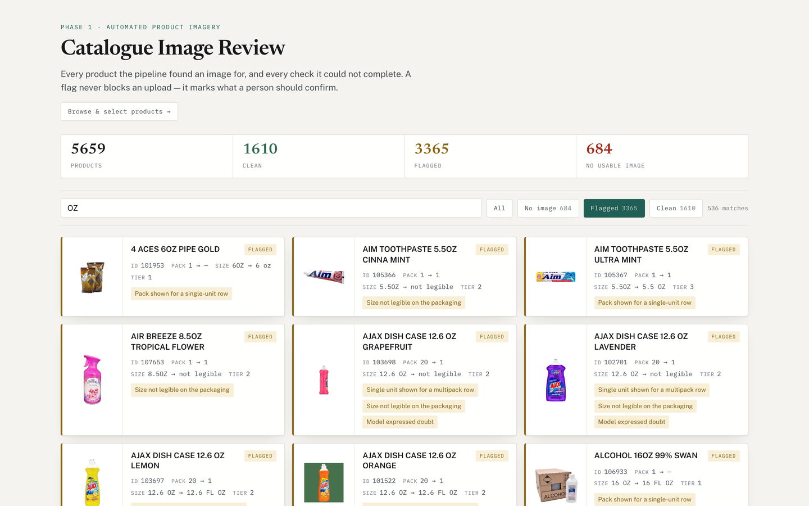
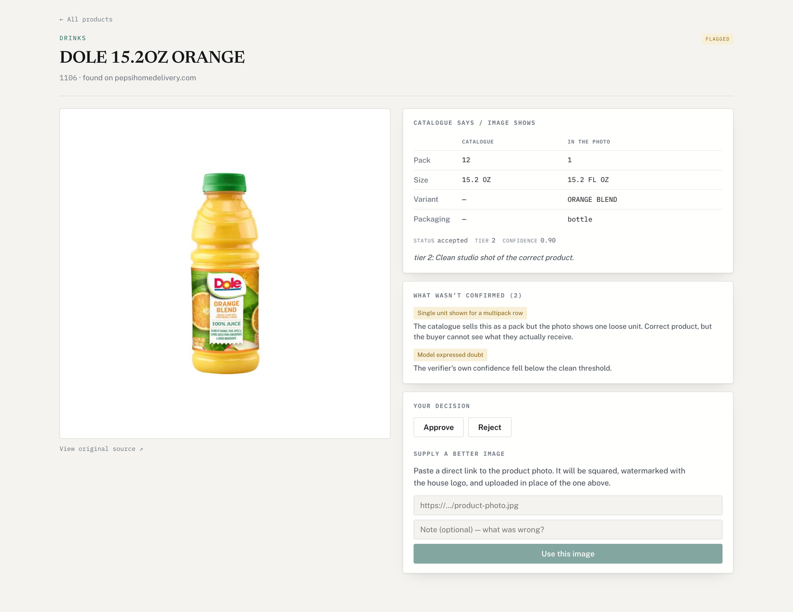
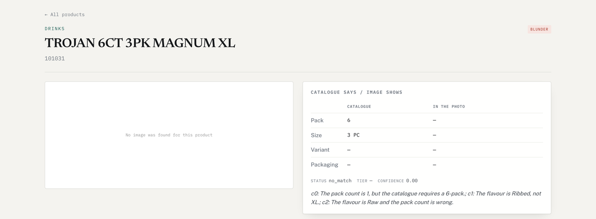
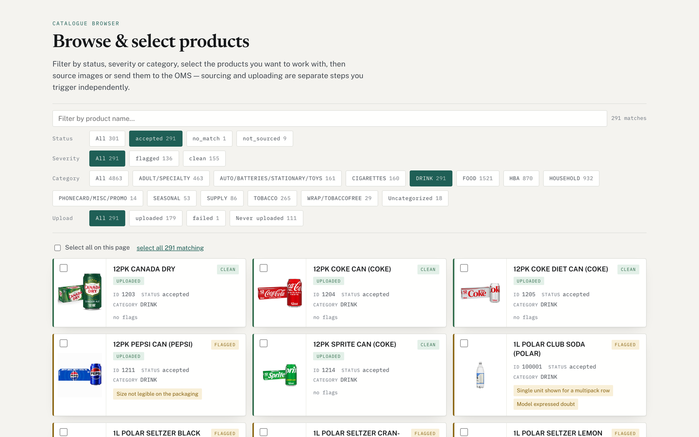

# Product Image Sourcing Agent

An agentic AI workflow that finds, verifies and publishes a correct product
photo for every item in a wholesale catalogue. A **vision-language model**
makes the judgement calls (is this the right product, which photo is best,
should it decline), a **web image search API** supplies the candidates,
**deterministic business rules** check every decision, and a **browser
agent** publishes approved images into the distributor's order-management
system (OMS).

Built for a US wholesale distributor with ~5,700 SKUs and no product imagery.



## Results

| | Products |
|---|---|
| Catalogue rows processed | 5,738 |
| Accepted with a verified image | 4,863 (85%) |
| Passed every check with nothing to flag | 1,610 |
| Correctly declined: no candidate was the right product | 684 |
| Published to the live storefront | 4,185 |

## The core problem

Downloading product photos is easy. Knowing a photo is **the right one** is
the hard part.

A search for `COKE 20OZ` returns 2-liter bottles, 12-packs, old label
designs, Diet Coke, photos of a fridge shelf and images with a price sticker
on them. The catalogue itself is written in trade shorthand
(`PRINGLE LG SALT & VINEGAR`, `TROJAN 6CT 3PK MAGNUM XL`,
`AJAX DISH CASE 12.6 OZ GRAPEFRUIT`), and the same word can mean different
things: "OZ" is volume on a drink and weight on a candy bar.

The business rule that shapes everything: **a wrong image is worse than no
image.** Wholesale buyers order by the case, so the wrong flavour, size or
pack count on a listing turns into wrong orders and returns. The agent is
built to refuse, and to say why, rather than attach the closest-looking
picture.

## How the agent works

```
 catalogue row  ──▶  normalize  ──▶  search (tool)  ──▶  filter  ──▶  VLM judge  ──▶  rule gate  ──▶  decision
 "AJAX DISH CASE      expand         Serper Google       drop stock     observe, gate,   re-check pack   accepted /
  12.6 OZ             trade          Images API,         photo sites    rank, choose     and size in     review /
  GRAPEFRUIT"         shorthand      10 candidates                      or decline       code            no_match
                                                                                                             │
                     publish (browser agent)  ◀──  human review (app)  ◀──  flags + watermark  ◀────────────┘
                     Playwright drives the OMS      approve, reject,        what wasn't
                     admin UI, verifies every       or supply a             confirmed
                     write from the server reply    better image
```

| Step | What happens | Tooling |
|---|---|---|
| Normalize | Expand trade abbreviations (`ASST` → assorted, `LG` → large), drop vendor codes and bookkeeping marks from the **search query only**. The model always sees the original description. | Python |
| Search | Google Images search for the normalized description; keep the top 10 results. | **Serper.dev image search API** |
| Filter | Drop stock-photo agencies, whose images are watermarked by definition. Resolution is deliberately not a filter: a small correct photo beats a large wrong one. | Python |
| Judge | All candidates go to the vision-language model in **one call**, with the catalogue row's name, unit size and pack count. It follows a five-step rubric (below) and returns a structured verdict. | **Google Gemini 3.1 Flash-Lite** (multimodal), `google-genai`, JSON output validated by a Pydantic schema, temperature 0 |
| Gate | Re-check the model's choice in plain code against the catalogue's own pack count and size. | Python |
| Flag | Derive what could *not* be verified, as named flags a reviewer can act on. | Python |
| Watermark | Square the image to 1000×1000 and apply the distributor's logo. | Pillow |
| Review | People browse, filter, approve, reject or replace picks. | Next.js, React, Postgres |
| Publish | A browser agent operates the OMS admin UI (it has no API): finds each product, uploads to the right image slot, and confirms success from the server's response. | **Playwright** |

Every model call is traced to JSON: the exact prompts, each candidate's
observations, gate results, the verdict and token usage. Any decision can be
audited after the fact.

## The acceptance framework

This is the core of the project: an explicit, testable definition of what
makes a photo acceptable, split between what needs eyes (the model) and what
can be checked mechanically (code).

### 1. The model observes before it judges

For every candidate the model first records only what is visible, before
deciding anything: the flavour or variant printed on it, the container,
the per-unit size (or "not legible", never a guess), whether it shows a
single unit, a pack or both, the pack count if readable, whether the label is
legible, whether anything was **added on top** of the photo, and whether it is
official product photography or a shop snapshot.

Separating observation from judgement makes the reasoning inspectable: when a
decision is wrong, the trace shows whether the model misread the photo or
misapplied a rule.

### 2. Hard gates: any one failing makes a candidate ineligible

| Gate | Rule |
|---|---|
| **Variant** | The strictest gate. Whatever distinguishes this row from its shelf siblings must match: flavour, scent, colour, strength or nicotine level, formulation (regular / diet / zero / sensitive), model. A different variant is never acceptable however similar the packaging. A more specific name for the same thing is fine ("Mandarin Orange" for an ORANGE row). |
| **Container** | The packaging must be a form this product is actually sold in at this size (gum in a pack, not a bottle). If the catalogue names a container (`BTL`, `CAN`, `CARTON`), the photo must not contradict it. |
| **Size** | Compared as real quantities after unit conversion (1 L = 33.8 FL OZ, 1 LB = 16 OZ), not as text. "OZ" is resolved by product type: fluid ounces on drinks, weight on food and soap; the two are never converted into each other. |
| **Pack count** | A pack showing a different count than the catalogue fails. A single-unit shot asserts no pack count and passes. |
| **Clean** | Nothing added on top of the photo: no watermarks, no marketing badges or price flashes, no hands, people or staged props. Artwork printed on the real packaging is fine; the test is "added to the image?", not "is there text?". |

Gates **fail on contradiction, never on missing evidence.** Product photos
often don't show a legible size; that lowers confidence instead of rejecting
an otherwise correct photo.

### 3. Ranking: correctness first, then photo quality

Eligible candidates are ranked into representation tiers, all of them
acceptable:

| Tier | Shows |
|---|---|
| 1 | the single unit **and** the pack together |
| 2 | a clean single unit |
| 3 | the pack only, with name, variant and size legible |

Within a tier, and ahead of tier order, photo quality decides: official
studio photography on a plain background beats a shop or phone photo, and a
legible label beats an illegible one. A clean tier-3 pack shot beats a blurry
shelf photo that happens to show unit and pack.

### 4. Choose, or decline

If any candidate is eligible the model must pick one; declining is reserved
for "nothing passed the gates". It then re-reads its own observations for the
chosen photo and confirms the gates were applied honestly (self-consistency
check) before answering.

### 5. Deterministic gate in code

The model's choice is re-validated against the catalogue's real fields:

- the chosen candidate must have passed all of its own gates and carry no
  overlay;
- a pack showing the wrong count is revoked;
- a volume size (mL, L, FL OZ) is converted to millilitres and must match
  the catalogue within 6%.

Code can only **revoke** a choice, never approve one the model rejected. LLM
for the judgement that genuinely needs eyes; code for everything that can be
checked exactly.

### 6. Decision thresholds

| Model confidence (after the gate) | Status |
|---|---|
| ≥ 0.80 | `accepted` |
| 0.50 – 0.80 | `review`: a person decides |
| < 0.50, or no eligible candidate | `no_match`: no image rather than a wrong one |

Confidence means "how sure this is the right product, clearly photographed".
The rubric explicitly forbids lowering it just because a photo shows a unit
instead of a pack.

### 7. Flags: making the checks you *couldn't* run visible

Passing the gates means nothing contradicted the catalogue. It does not mean
everything was confirmed. Each accepted product carries named flags for what
was not verified, and a severity of `clean`, `flagged` or `blunder`:

| Flag | Meaning |
|---|---|
| Single unit shown for a multipack row | Right product, but the buyer can't see the pack they receive |
| Pack shown for a single-unit row | The photo shows a case for a product sold singly |
| Pack count not readable | A pack is shown but its count couldn't be read |
| Size not legible on the packaging | The catalogue size was never confirmed against the photo |
| Catalogue has no size to check | The row has no usable size, so neither side could be checked |
| Size/format qualifier not confirmed | The row says KING SIZE, JUMBO or MINI and the photo doesn't show it |
| Label not readable | Name, variant or size can't be read |
| Not official product photography | A shop or phone photo; acceptable, but a better one likely exists |
| Assorted/variety row | Mixed flavours, so no single photo is strictly correct |
| Model expressed doubt | Confidence at or below 0.90 |

**A flag never blocks an upload; it marks what a person should confirm.**
That let the client publish thousands of correct images immediately and spend
review time only where it mattered, prioritised by flag.

### Business rules for publishing

- Only `accepted` products publish; `review` items need a human decision first.
- Products are matched in the OMS by **exact item number**. Zero or several
  matches means skip and report, never guess.
- Images go only into the distributor's own image slot. The OMS also has a
  shared master slot that other distributors read; the agent verifies which
  slot is active before every write and refuses otherwise.
- An upload counts as done only when the server's response names that file
  as a success. The UI's success toast is not trusted.
- Only watermarked images are published; a missing watermark stops the
  product rather than falling back to the unbranded original.
- Everything is resumable: every outcome is written as it happens, so a crash
  or an expired session picks up where it stopped.

## The interface

**Product detail.** What the catalogue says next to what the model read off
the photo, the model's verdict and confidence, and every check that couldn't
be completed. A reviewer can approve, reject, or paste a link to a better
image, which is then squared, watermarked and queued for upload.



**A correct refusal.** For this row the model rejected all three candidates
and said why: one showed a single unit for a 6-pack, the other two were
different variants (Ribbed, Raw) of the same brand.



**Browse and act in bulk.** Filter by status, flag severity, category and
upload state, select products, then re-run sourcing on them, download their
images, or send them to the OMS.



## Engineering notes

- **One call per product, all candidates at once.** The model compares
  candidates side by side instead of scoring each in isolation, which is
  both cheaper and better at picking the best of several correct photos.
- **Repeatable.** Temperature 0 and a strict response schema, so re-running a
  product gives the same verdict.
- **Robust long runs.** Retries with backoff on transient API errors and a
  hard per-request deadline, added after a dead connection froze a production
  run for three hours.
- **Image generation was tried and rejected.** AI background replacement is
  implemented in `enhance.py` but switched off: across 34 test products it was
  inconsistent and often overpowered the product. Real photos on white won.

## Tech stack

| Area | Tools |
|---|---|
| Vision-language model | Google Gemini 3.1 Flash-Lite via `google-genai`, structured JSON output with Pydantic |
| Search | Serper.dev Google Images API |
| Pipeline | Python 3.11+, Pillow, openpyxl |
| Review app | Next.js 15, React 19, TypeScript, Drizzle ORM, PostgreSQL |
| Browser agent | Playwright |
| Tests | pytest, Vitest, ruff |

## Run it

```bash
make install                      # .venv, dependencies, Chromium
cp .env.example .env              # add SERPER_API_KEY and GEMINI_API_KEY
INPUT_CSV=data/sample_catalogue.csv make source LIMIT=3
make review                       # static review page for the picks
make test
```

The real catalogue and logo are confidential; `data/` holds a ten-row made-up
sample and a placeholder logo instead (see [`data/README.md`](data/README.md)).
Each row costs one search call and one model call, so start with a small
`LIMIT`. Screenshots show the original sourced photos; published images also
carry the distributor's watermark.

Publishing needs an account on the target OMS, so it won't run as-is; the
OMS-specific selectors are isolated in
[`oms_selectors.py`](src/lowprice/phase2/oms_selectors.py).

## Layout

```
src/lowprice/
    phase1/normalize.py   catalogue shorthand → search query
    phase1/search.py      Serper image search
    phase1/process.py     stock-photo filter, download, square
    phase1/verify.py      the vision-language model rubric and call
    phase1/gate.py        deterministic re-check of the model's choice
    phase2/               browser-agent uploader and OMS selectors
    pipeline.py           orchestrates one product end to end
    config.py             every threshold, model name and path
flags.py                  what-wasn't-confirmed flags and severity
app/                      review app
worker.py                 per-product upload worker
bulk_upload_woopsa.py     30-at-a-time bulk uploader
tests/                    pytest suite
docs/reference.md         detailed design notes
```
